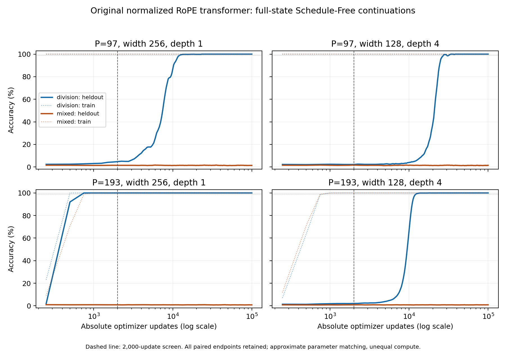

# Long continuation of the normalized RoPE arithmetic screen

Does an early memorization plateau conceal delayed grokking? This is an
adaptive follow-up to the frozen2000-update screen, declared before any
continuation. Only Schedule-Free AdamW is used. The fixed source model,
labels, splits, seeds, batch size, rate, decay and moment parameters stay
the same. Query, base, second moments, averaging clock and sampler state
are loaded from SHA256-pinned checkpoints. This is not a fresh optimizer
restart. Python3.15/Torch2.15 and CUDA max-autotune remain required.

| Cases | Count | Purpose |
| --- | ---: | --- |
| Division and mixed pairs, P97/P193, W256D1/W128D4 | 8 | Rank-one versus flat character routes; early width/depth differences |
| Full-table mixed P193, W256D1 | 1 | Whether incomplete fitting at2000 updates persists |
| One-step chain P97, W128D4 | 1 | Whether a longer budget learns the local mixed update |

Each target is100000 **absolute** updates, continuing from2000. Evaluation
every250 updates is retained, including its normal Schedule-Free mode
roundtrips. Checkpoints every10000 updates are retained, together with the
initial2000 state. There is no early stopping or held-out selection; report
the final model, every measured transition above99%, and subsequent relapse.
For the chain, doubled length is evaluated only at its final endpoint.

The cohort shares one **two-hour wall-time cap**, including compilation and
evaluation. The fixed order is recorded in `experiment.py`. If it runs out,
stop the active process and preserve its last complete atomic checkpoint;
report it as unfinished, alongside not-started cases. A timeout is not
evidence that a task cannot be learned. `run_bounded.py` refuses to allocate
a second budget automatically and records start/end times and case status
in root-linked ignored `runs/phase.json`. The original screen remains intact.

All ten cases completed at 100,000 updates in 6,283.38 seconds (1h44m43s),
including compilation and evaluation, within the single 7,200-second cap.
No case timed out or was omitted. Profiles were completed before starting.
The counterexample criteria and limits are inherited
from `../modular_composition/falsification.json` and repeated in the frozen
`hypotheses.json`. The target is to test missing learning implications, not
to weaken valid exact kernel-completion theorems.

Validation: the complete CPU-visible `./run.py test` passed446 lab tests
(13 CUDA-dependent skips) and104 optimizer tests (14 skips). The new
continuation test compares query, complete optimizer state and exact next
sampler state with uninterrupted training on both pairs and chains. The
budget-supervisor test checks successful exit and termination while keeping
the child's log. Earlier CUDA validation retains the two documented Muon
allocation failures; no new failure is hidden by this CPU validation.

```sh
./run.py check experiments/modular_composition_long
# From python/, after profiling and protocol commit:
uv run --locked python ../experiments/modular_composition_long/run_bounded.py
```


## Completed outcomes

All paired runs use their declared seed 11 and finish at 100,000 updates.
The widths approximately match parameter counts, but differ in head dimension
and compute. The original source arithmetic is preserved throughout.

| Task | Prime | Shape | Heldout at 2,000 | Heldout at 100,000 | First measured ≥99% |
| --- | ---: | --- | ---: | ---: | ---: |
| Division | 97 | W256D1 | 4.725% | 100% | 12,500 |
| Division | 97 | W128D4 | 2.255% | 100% | 27,500 |
| Division | 193 | W256D1 | 100% | 100% | 750 |
| Division | 193 | W128D4 | 2.062% | 100% | 12,250 |
| Mixed | 97 | W256D1 | 1.467% | 1.360% | Not reached |
| Mixed | 97 | W128D4 | 1.700% | 1.445% | Not reached |
| Mixed | 193 | W256D1 | 0.881% | 0.816% | Not reached |
| Mixed | 193 | W128D4 | 0.838% | 0.854% | Not reached |

The P97 deep division run relapses below 99% at 30,000 updates and returns
at 32,000; it is not represented only by its first successful checkpoint.
The first crossings correspond respectively to 657.93, 1,447.38, 10.28 and
167.82 actual data epochs. All four division final checkpoints reproduce
100% on independent CPU replay. The four mixed pairs fit every training row;
perfect fitting therefore does not explain their different heldout outcomes.



The full-table mixed P193 control improves from 58.62% training accuracy to
100%; its first measured 99% fitting point is 4,000 updates. No heldout result
is defined for that control. The P97 one-step chain W128D4 finishes at
99.854% train, 1.270% heldout, and 0.684% at doubled chain length. Compare
the split-specific majority and copy-last baselines retained in `results.json`;
the uniform chain copy baseline is (2P-1)/P², not 1/P.

`analyze.py` checks every initial continuation state against its source,
bitwise across the model, complete optimizer, sampler and counters. Only
inspection timing is excluded. It verifies pinned source/protocol hashes,
all ten 100,000-step endpoints and every retained checkpoint. `results.json`
contains all early-plus-long curves, crossings, relapses, epochs, wall times,
provenance and final-state replays. There is no heldout checkpoint selection.
The original 3e-4 absolute/relative loss tolerance and exact answer counts
are retained; CPU discrepancies receive a compiled follow-up, not a wider
tolerance. The recorded training-time results above remain distinct from
replayed metrics.

`residual_diagnostics.json` and `residual_comparison.json` compare identical
first-512-row batches at 2,000 and 100,000 updates. Their manual forwards agree
bitwise with the source in all 32 batches. Ambient position gradients and
shared-parameter gradients are reported separately. These measurements do
not establish that a different residual architecture would learn better.

The valid spectral recovery theorems survive. The rejected inferences are
that rank-one availability predicts a short learning time, or that an early
memorization plateau establishes permanent failure. The flat mixed tasks
have not supplied a successful heldout counterexample; their finite failures
do not prove impossibility. See the updated falsification ledger and
`review/flat_spectrum.md` for the precise remaining gaps.


Final replay audit: CPU evaluation differs by one heldout answer for each
of the two deep mixed endpoints. Both then reproduce the recorded answer
counts through the original compiled CUDA path, with losses inside the
unchanged tolerance. All ten final success/failure classifications agree.
The CPU differences remain in the JSON alongside the compiled follow-ups.
Unlike the early screen's two remaining compiled discrepancies, no long
endpoint has an unresolved compiled count or tolerance failure.

Validation: the final CPU-visible `./run.py test` passes 446 lab tests
(13 skips) and 104 optimizer tests (14 skips), and the local reference archive
hashes pass. These skips do not erase the separately recorded historical CUDA
Muon allocation failures. The source model in this study uses only
Schedule-Free AdamW. The separate diff_gpt numerical correction and its
compiled three-seed regression are not applied to these trajectories.
