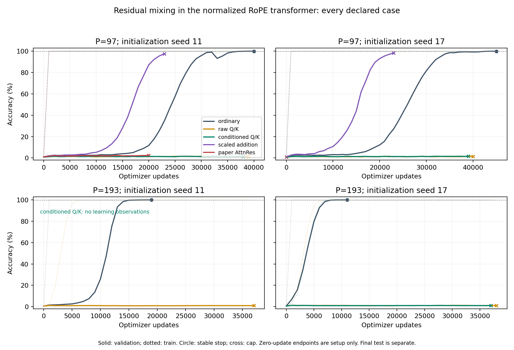

# Residual mixing: ordinary addition succeeds; scaling learns earlier

Task145 is closed. Ordinary residual addition passed the declared validation
rule in all four primary controls and scored 99.96–100% on final test. Raw and
conditioned Q/K depth attention fit training examples but remained near chance
within their 37–40k-update allowances. This establishes a delay in this setting,
not an impossibility result. The corrected coordinate scale stayed exactly one
in every recorded query: the previously repaired oversized-query condition did
not occur here, so this cohort does not demonstrate an active repair benefit.

Fixed branch scaling produced an earlier generalization transition in both P97
seeds. At 23,000 updates its validation accuracy was 97.60%/98.37%, compared with
34.97%/27.23% for ordinary addition at the same update. Final test was 97.77%/98.37%.
These shorter controls were time-censored before the 99.9% stability rule; ordinary
addition subsequently reached 99.96% test. The result motivates branch-strength
experiments, not a claim of superiority at the final target.

The paper-style key-only control reached 20k updates in one seed, with 2.79% test;
the second seed was stopped during setup by the global deadline. Keeping the
host's Peri output norms, QK-normalized token attention and centered XSA differs
from the AttnRes paper's full model. These limited controls do not settle whether
residual attention as a general idea works.

## Every declared endpoint

| Case | Updates | Final test accuracy | Outcome |
| --- | ---: | ---: | --- |
| division-s11-p97-add | 40,000 | 99.957% | stable validation |
| division-s11-p97-qk | 39,000 | 1.675% | time limit |
| division-s11-p97-conditioned | 38,000 | 1.589% | time limit |
| division-s11-p193-add | 19,000 | 100.000% | stable validation |
| division-s11-p193-qk | 37,000 | 0.896% | time limit |
| division-s11-p193-conditioned | 0 | initial state only | capture failure before learning |
| division-s17-p97-add | 45,000 | 99.957% | stable validation |
| division-s17-p97-qk | 40,000 | 1.418% | time limit |
| division-s17-p97-conditioned | 39,000 | 1.890% | time limit |
| division-s17-p193-add | 11,000 | 100.000% | stable validation |
| division-s17-p193-qk | 38,000 | 1.015% | time limit |
| division-s17-p193-conditioned | 37,000 | 0.993% | time limit |
| mechanism-s11-scaled | 23,000 | 97.766% | time limit |
| mechanism-s11-attnres | 20,000 | 2.792% | time limit |
| mechanism-s17-scaled | 23,000 | 98.368% | time limit |
| mechanism-s17-attnres | 0 | initial state only | global limit during setup |

Two zero-update checkpoints are retained for audit, not presented as learning
results. One conditioned P193 case failed in CUDA graph capture at its first
observation; the last key-only case exhausted the phase while preparing. No
failed case was replaced. No continuation could start within the remaining
predeclared allowance. All 449,000 saved update-gradient norms are finite.

[Complete results](results.json), [protocol](protocol.json),
[source integrity](integrity.json), [profiling](profiling.json),
[endpoint mechanism measurements](mechanism.json).

[Vector learning curves](learning_curves.svg),
[wall-time curves](learning_wall_time.svg). Dotted curves are training accuracy;
solid curves are validation. Final test was opened only after learning closed.
The reporting plot was repaired after closure to retain a failed empty-history
case; the frozen scoring and learning code were unchanged.

## Matched architecture and learning protocol

Every case uses width 128, depth 4, four heads, the source's exact RoPE,
Q/K normalization in token attention, centered/clipped XSA with its repeated-prefix
guard, SwiGLU, Peri-RMSNorm and tied readout. Input length is two; context capacity
is 33. The Q/K variants change depth mixing, not token-attention normalization.

| Variant | Depth recurrence | Extra learned parameters |
| --- | --- | ---: |
| add | Ordinary residual addition | 0 |
| scaled | Addition with branch coefficient 1/sqrt(8), after output RMSNorm | 0 |
| attnres | Key-only scores, zero queries, learned key gain | 2048 |
| qk | Parameter-free query/key RMS, unit-RMS initial queries, sqrt(width) divisor | 1024 |
| conditioned | Same Q/K formula plus complete-state query conditioning | 1024 |

Depth attention reads the embedding and each completed branch exactly once,
including a final aggregation. There is no extra ordinary residual alongside
that aggregation. Common matrices are initialized before additional query draws.

Primary comparisons use primes 97/193 and initialization seeds 11/17. The two
mechanism controls use prime 97 and both seeds. Data and batch seed 11 are shared.
The training split is the original half-table; its old held-out half is divided
into disjoint validation/test quarters. Division always excludes denominator 0.
The task is unseen pairs at each fixed prime, without an OOD prime/length claim.

Learning uses only Schedule-Free AdamW: lr 0.003, betas(0.9,0.98), decay 0.1,
ten outer warmup updates, batch 256, evaluations/checkpoints every 1,000 updates.
Python 3.15.2, Torch 2.15.0+cu132, fullgraph max-autotune, math SDPA, RTX 3050 Laptop, 4 GiB.
Stop at the current endpoint after three consecutive train/validation observations
both reach 99.9%, each at or after update 5,000. There is no best-checkpoint restore.
The theoretical update caps are 100k primary/30k mechanism. Frozen first-pass
allowances were 204s/102s after preparation; setup still counted globally. One
fixed-order continuation round was declared, but the global cap left no time.

The single GPU phase used 7,165.75 of 7,200 wall seconds (119m25.75s), including
profiling, compilation, failed attempts, learning, and final disposable capture
checks. The old modular-composition budget was not reused. CPU final replay,
regressions and the subsequent synthetic task do not start new GPU learning.

## Audits and interpretation

CPU FP32 replay reproduces every available CUDA train/validation count exactly.
The FP64 audit fixes dtype-dependent RMS epsilon to its FP32 value; there are
zero prediction disagreements across all train/validation/test splits. Both
ordinary and scaled endpoints classify every tested zero-numerator and equal-
operand example correctly. Ordinary P97 endpoints each miss one other test pair;
this is not an all-input correctness theorem.

The post hoc mechanism audit measures true CE derivatives at the saved
Schedule-Free training iterate on the first 256 training rows. Every trained
depth-query probe has a nonzero gradient. Local RMS VJPs are checked against
independent FP64 autograd, excluding other paths into the same residual tensor.
On distinct operands none of the measured branch output norms is epsilon-
dominated. Successful ordinary models also show substantial normalization gain
(up to about 105 on this probe). These measurements do not identify a blanket
normalization bug or prove the cause of delayed generalization.

The warmed math backend gives about 228/198/194/224 updates/s for add/raw-QK/
conditioned/scaled. The old automatic-kernel add diagnostic was about 133/s.
Selecting SDPA inside both compiled graphs was necessary; an outer-only context
left cached kernels unchanged. All completed forward/gradient diagnostics agree
with eager arithmetic within 2.9e-6/3.9e-7. Key-only profiling was incomplete.
Raw profiler failures, sampling errors, malformed sampling records and all
compiler time remain documented in [profiling.json](profiling.json).

A disposable fixed-batch evaluation candidate passed repeated initial evaluation
and tail sizes 1/48/96/512, with maximum logit error 3.46e-6 and matching CPU/CUDA
counts. It took no optimizer steps. The original diagnostic hit its setup limit;
the candidate is not claimed to establish the root cause or repair every resumed
training path. It did not replace the failed cohort case.

The existing Lean coordinate identities and score bounds remain valid: they
never promised optimizer convergence or generalization. Flat task spectrum alone
does not rank these optimization trajectories. Keep ordinary addition as the
working baseline, and pursue the requested known-solution normalization/gradient
benchmark in task 151 before another full transformer change.

## Regression coverage and reproduction

GPT commit 5d71786 adds both independently learned scaled endpoints as CPU
held-out regressions. The actual GPT reproduces every frozen prediction. Turning
their branch coefficient back to one drops test accuracy to 36.21%/43.77%, so the
negative control detects a meaningful loss of the learned function. These tests
protect learned behavior, not a stochastic training-speed guarantee. The affected
GPT suite passes 173 tests with 15 CUDA-only skips. Commits 9d16e39/cf1d7c8 also test
the full-model query-gradient repair and reject a disabled conditioner.

The unchanged frozen cohort scripts, source hashes and complete optimizer/sampler
states are recorded by [protocol.json](protocol.json) and the local `runs/` directory.
Explicit CPU replay, from `python/`, uses `uv run --locked python
../experiments/residual_generalization/analyze.py`. Endpoint audits use
`uv run --locked python ../review/residual_transformer_diagnostics.py`.
The latter requires the frozen engine source. Plot exports use system Matplotlib;
training and all numerical replays use the locked Python 3.15/Torch 2.15 runtime.
