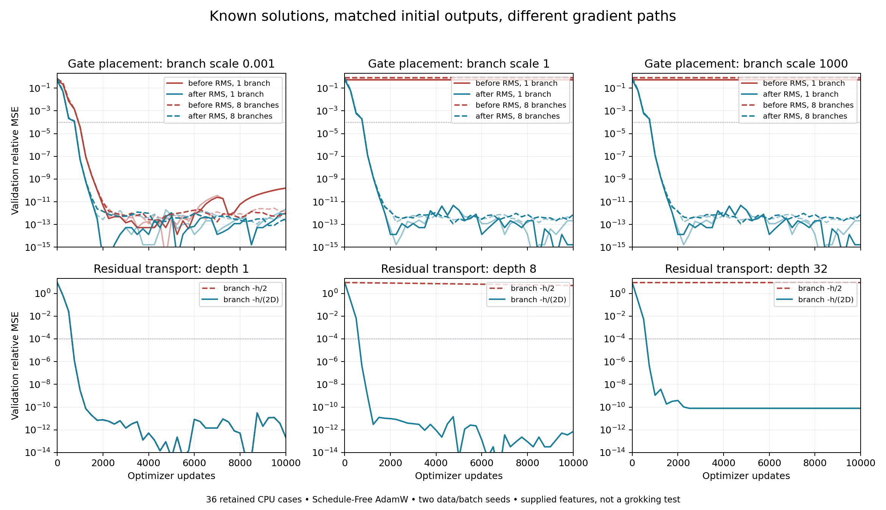

# Known-solution residual gradient benchmarks

All 36 cases completed: 360,000 updates, no discarded or censored case,
171.11 seconds of scored CPU execution including preparation. Only
Schedule-Free AdamW was used. Final test was opened after learning closed.

| Comparison | Recovered cases | Final test relative MSE |
| --- | ---: | ---: |
| Gain after RMS, all scales and branch counts | 12/12 | <=2.26e-12 |
| Gain before RMS, scale .001 | 4/4 | <=1.62e-10 |
| Gain before RMS, scales 1 and 1000 | 0/8 | 0.528–0.837 |
| Ordinary contracting transport, depth 1 | 2/2 | 2.28e-13 |
| Ordinary contracting transport, depths 8/32 | 0/4 | 4.93 / 9.00 |
| Depth-scaled transport, depths 1/8/32 | 6/6 | <=7.79e-11 |

Successful gate cases crossed validation relative MSE 1e-4 at update 1,000;
successful transport cases at 750 (observed every 250 updates). All continued
to the declared 10,000-update cap. These are supplied-feature recovery tasks,
not delayed generalization experiments. Both transport seeds have identical
scalar losses/trajectories by symmetry; they are different input samples,
not independent optimization conditions.

[Every endpoint and full curves](results.json), [frozen protocol](protocol.json),
[high-precision and FP32 oracles](oracles.json), [compile profile](profile.json),
[vector plot](learning_curves.svg).

Task 151 tests whether a useful scalar direction receives a usable gradient.
It is inspired by `GPTMini.rmsNormEps`, `GPTMini.rmsNorm_pos_homog` and
`Residual.residualRun` in this Lean project. It supplies the useful features;
learning them, attention selection and modular grokking are separate questions.

## Equations and known solutions

1. Gate placement: independent sign vectors have RMS exactly one. The teacher
   is `x0 + sum(c[j]*v[j])`, with c cycling through 1/4, 1/2, 3/4. A gate is
   `g=2*sigmoid(s)`, initialized at s=0. Before normalization, the branch is
   `RMS_eps(g*a*v)`; after normalization, it is `g*RMS_eps(a*v)`.
   Both initial functions agree. There are no learned norm scales or biases.
2. For either placement the teacher is representable: before RMS the optimal
   gate is `sqrt(eps)*c/(a*sqrt(1-c*c))`; after RMS it is
   `c*sqrt(a*a+eps)/a`. Every declared optimum lies strictly between 0 and 2,
   with finite logit `log(g/(2-g))`. These differ in conditioning, not capacity.
3. The scalar normalized amplitude is `f(z)=z/sqrt(z*z+eps)` with derivative
   `eps/(sqrt(z*z+eps)^3)`. At initialization the ratio of before/after gate
   derivatives is `eps/(a*a+eps)`. Epsilon is explicitly 2^-23, including in
   FP64 checks. Ideal scale invariance does not imply zero real derivative
   at positive epsilon. Decimal arithmetic checks very small derivatives;
   FP32 autodiff is separately measured, not presumed exact.
4. Transport: `h[0]=w*x`, `h[l+1]=h[l]+c*h[l]`, so output is
   `w*(1+c)^D*x`. Compare c=-1/2 with c=-1/(2D). Each starts at
   `w=(1+c)^(-D)` and therefore output x; the teacher is x/4, represented
   by `w=(1+c)^(-D)/4`. The derivative in w is `(1+c)^D*x`.
   For ordinary branches this is 2^-D; depth scaling keeps the gain >=1/2.
   Thus an identity skip alone does not lower-bound the complete Jacobian.

## Frozen comparison

| Family | Variations | Paired cases |
| --- | --- | ---: |
| Gate placement | before/after; scale .001/1/1000; 1/8 branches | 24 |
| Residual transport | ordinary/depth scale; depth 1/8/32 | 12 |

Width 32; data and batch seeds 11/17; deterministic initialization. Each case
has 512 training, 256 validation, 256 sealed test inputs, unique and disjoint.
Only Schedule-Free AdamW, lr .01, betas (.9,.98), epsilon 1e-8, decay zero;
10,000 updates, batch 64, observations/checkpoints every 250. Zero decay avoids
shrinking a parameter toward a small teacher coefficient without its gradient.
All cases run to the fixed cap, including failed controls. Relative validation
MSE <=1e-4 marks recovery; final reporting also checks effective coefficients
and the all-sign-input error bound `sqrt(width)*sum(abs(coefficient error))`.
No tiny unnormalized label loss is counted as success.

Python 3.15 / Torch 2.15, CPU one thread, fullgraph max-autotune. No new GPU
phase. A disposable preparation/profile and independent oracles precede scored
learning. The protocol records all engine and experiment source hashes before
learning; any failure remains in the ledger. Final test is opened only after
all declared learning closes. These runs cannot establish or refute grokking.

Run with `./run.py check experiments/residual_gradient_paths`, then
`./run.py run experiments/residual_gradient_paths`. The cohort wrapper also
freezes provenance and closes learning before final replay (see `cohort.py`).

## What failed, and what was repaired

At scale one all four pre-RMS runs had exactly zero gradient on every update.
At scale 1000, one-branch runs had zero gradient after the first update; the
eight-branch runs retained tiny rounding-dominated gradients without amplitude
recovery. Decimal and FP64 checks distinguish a small positive real derivative
from FP32 cancellation. After-RMS gains recovered every coefficient within
1.52e-6. Increasing supplied branches from one to eight did not fix the
pre-RMS amplitude problem. This does not imply RMSNorm is generally harmful:
normalization deliberately removes radial information, and a transformer can
learn other directions. The repaired degree of freedom is branch strength.

At depth 32, ordinary transport starts with w=2^32 to match the depth-scaled
initial output. Its first gradient is nonzero (3.49246e-10), but the ideal first
base step is only 0.00033746 while the next smaller FP32 parameter is 256 away.
The actual update leaves w unchanged. Depth scaling keeps the transport gain
at least 1/2 and its initial parameter at most 2. At depth eight the ordinary
run is still moving: its failure is budget/conditioning evidence, not a proof
that more updates cannot solve it. A zero gradient alone also is not a failure
criterion: the successful depth-scaled depth-32 query reaches a numerical floor.

The local Lean module `Transformer.Residual.GradientPaths` proves the connection
to the existing vector RMSNorm, its finite-epsilon radial derivative, the exact
gate derivative ratio, the actual residual recurrence and derivative, a zero-
derivative counterexample despite an identity skip, and the depth-scaled lower
bound. All hypotheses have explicit examples. No `sorry` or axiom was added.
The norm bound reported from coefficients is a real-arithmetic diagnostic using
floating-point coefficient estimates; it is not an interval certificate for
every rounded FP32 operation. Final eager replay differs from the recorded
compiled validation relative MSE by at most 1.69e-8.

GPT commit `379a9f2` adds optional `ResidualGPT(..., mixing="gated")`: one
`2*sigmoid(s)` coefficient after each attention/FFN output RMSNorm, initialized
at one. Ordinary behavior remains available. Tests cover full equations and
all parameter gradients with unequal gates, causality, KV caching, checkpointing,
initial ordinary-model parity, and held-out amplitude recovery. A deliberately
misplaced normalization fails the regression. The affected GPT suite passes
179 tests with 15 CUDA skips; a focused self-review passes 26 tests and rejects
the mutation. This establishes the mechanism and integration, not a full-model
grokking advantage. The fixed-scale task145 improvement remains distinct.

## Profiling and limits

The first disposable depth-32 compile was interrupted after minutes in
TorchInductor's recursive operation counting. The raw traceback is retained
in `.kanban/artifacts/151/profile-literal-recurrence.log`. Python 3.15's Tachyon
attach was denied by OS ptrace policy; no system policy was changed. Factoring
each fixed linear branch from `h+c*h` to `(1+c)*h`, justified by the Lean
recurrence identity, brought measured depth-32 setup to 2.27–3.00 seconds.
The recurrence still executes all D steps; floating-point rounding order differs.
Independent FP64 derivative/value tests and compiled/eager checks pass. Warmed
updates were approximately 1,300–2,800/s in the final disposable profile;
other CPU verification was running concurrently, so these are diagnostic rates. This is a compiler preparation
fix for a linear witness, not a measured transformer speedup.

The 36-case source hashes were frozen before scored learning. The model, data,
training and orchestration sources have not changed since. The original two-hour
GPU phase stays closed. Reports and plots are CPU-only postprocessing. Further
work should compare optional learned gates with the successful ordinary/fixed-
scale transformer controls under a newly authorized long-run budget; these small
regressions do not establish which generalizes sooner on modular division.

The complete review is [review/residual_gradient_paths.md](../../review/residual_gradient_paths.md).
Full CPU validation passed 468 lab tests (13 skips) and 104 optimizer tests
(14 skips); all six focused tests pass after strengthening compiled continuation.
